<picture>
  <source media="(prefers-color-scheme: dark)" srcset="assets/header-dark.svg">
  
</picture>

### Hi there 👋

I work where marketing meets engineering: **measurement, attribution, martech and growth systems**.
Software engineer by training, marketer by trade. I like turning messy marketing problems into systems that can be measured.

### 🚀 Building in the open

<a href="https://github.com/HojatGhanad/open-server-side-first-party-event-relay">
  <picture>
    <source media="(prefers-color-scheme: dark)" srcset="assets/project-dark.svg">
    
  </picture>
</a>

### 🧰 Toolbox

  

### 📫 Elsewhere

